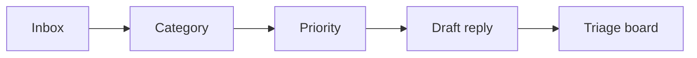

# Email Triage Assistant

> Sorts the inbox into act now, reply today, read later and ignore, and drafts the replies.

     

**Sector:** Productivity  ·  **Project 13 of 50** in my [AI Automation Projects series](https://github.com/Princewill106/Princewill106)

## The problem

A busy professional's inbox mixes a client asking for a contract change with forty newsletters and a phishing attempt. Triage happens in their head every morning, burns an hour, and the urgent client email still gets missed.

## How it works



1. **Read** — Emails come from a JSON export (`sample_emails.json`) or an .mbox file (`--mbox`).
2. **Categorise** — Sender domain, subject and body keywords decide the category; VIP senders are configurable.
3. **Prioritise** — Urgency words, deadlines, VIPs and questions raise priority; newsletters and no-reply senders lower it.
4. **Draft** — Emails that need a response get a short draft reply.
5. **Board** — Everything lands in four buckets saved to `output/triage.md`.

## Features

- Works with .mbox exports from Gmail Takeout and Outlook
- VIP sender list
- Phishing heuristics (lookalike domains, urgent payment requests)
- Four-bucket triage board
- Reply drafts (template or LLM)

## Quick start

```bash
git clone https://github.com/Princewill106/email-triage-assistant.git
cd email-triage-assistant
python main.py --demo
```

No installs needed: it uses only the Python standard library. The demo runs fully offline using the sample data in this repo.

**Optional: plug in an LLM.** Copy `.env.example` to `.env` and add an Anthropic or OpenAI key. The project will then use the model for the language-heavy steps and fall back to its rule-based logic if a call fails.

Run the tests:

```bash
python -m unittest -v
```

## Sample output

```text
== Act now (1) ==
  [client    ] mrs.ade@brightschools.ng       Contract change before Friday
      draft: Hi Mrs, thanks for the update. I'll review and come back to you by end of day.
== Reply today (1) ==
  [meeting   ] tunde@harbourtraders.ng        Quick call next week?
      draft: Hi Tunde, thanks. Tuesday or Wednesday after 2pm works for me. Which suits you?
== Read later (1) ==
  [invoice   ] accounts@ekopower.ng           Invoice EPS-221
== Ignore / report (3) ==
  [phishing  ] security@paypa1-support.com    Action required
  [newsletter] newsletter@techcabal.com       Weekly digest: African tech
  [meeting   ] no-reply@zoom.us               Recording available

Saved output/triage.md
```

## Use it in n8n (no code needed)

[`n8n-workflow.json`](n8n-workflow.json) is a ready-to-import n8n version of this project, built for n8n 1.x.

1. In n8n, open **Workflows → Import from File** and choose `n8n-workflow.json`.
2. Click **Test workflow**. It runs the full logic on the sample data built into the *Sample data* node, so you can see the results before connecting anything.
3. Open each output node and connect your accounts: Gmail (OAuth2), Google Sheets (OAuth2), Slack. For Google Sheets, pick your spreadsheet and sheet.
4. Adjust the settings at the top of the **Logic** node (thresholds, templates, contacts), then **Activate**.

**Flow:** **Gmail Trigger** → **Logic** (Code node) → **Route** (Switch)

**Outputs:**
- Ping me now (Slack)
- Add to 'reply today' sheet
- Flag suspected phishing

The Logic node is a JavaScript port of the rules in `main.py`, so you can run the project in n8n without Python.

## Use it on your own data

Export your mailbox (Gmail Takeout gives .mbox) and run `python main.py --mbox inbox.mbox`, or pass JSON with `from,subject,body`. Put important senders in `VIPS`.

## Project structure

```text
n8n-workflow.json            Importable n8n workflow
.env.example                 Optional API key settings
.gitignore                   Git ignore rules
LICENSE                      MIT license
README.md                    This file
llm.py                       Optional LLM helper (offline fallback)
main.py                      Entry point and core logic
requirements.txt             Dependencies (stdlib only)
sample_emails.json           Sample input data for the demo
test_main.py                 Unit tests
```

## Who this is for

- Founders and executives
- Executive assistants
- Customer-facing teams sharing an inbox

## Ideas to extend it

- [ ] Gmail API live mode with labels
- [ ] Calendar-aware meeting replies
- [ ] Learn VIPs from reply history
- [ ] Daily 8am digest

## About

Built by **Ogbu Ugochukwu Princewill**, AI Automation Lead and robotics engineer. I teach people and businesses to build with AI, not just talk about it. [LinkedIn](https://www.linkedin.com/in/ugochukwu-ogbu-653a0816a)

If this helped you, give it a ⭐ and share what you built with it.

## License

MIT — see [LICENSE](LICENSE).
